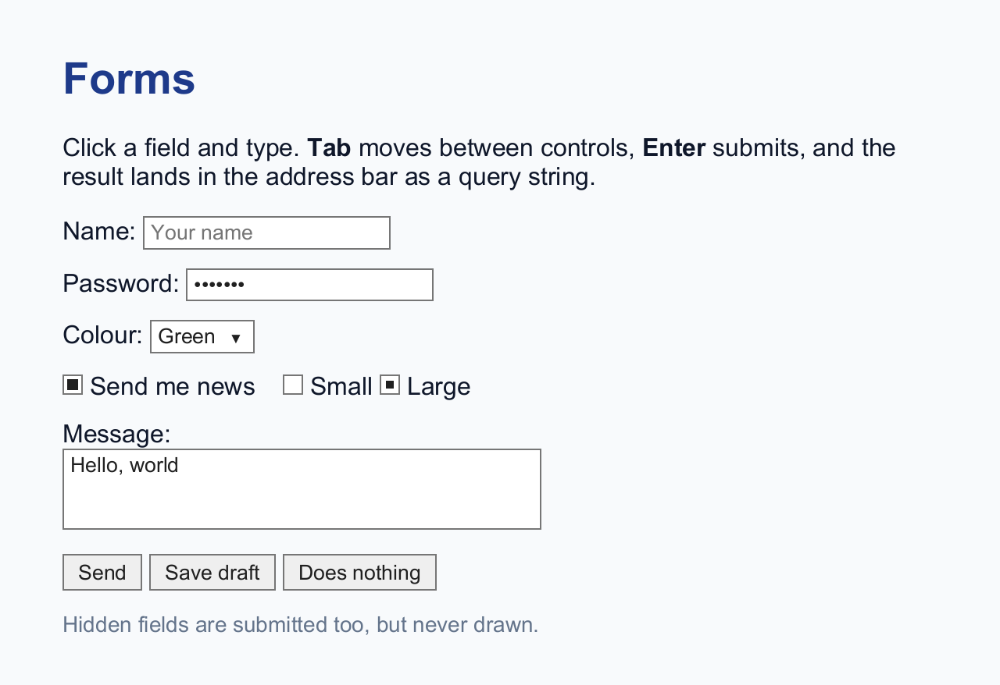

# mybrowser

I wanted to understand what a browser actually does, so I'm writing one from scratch in Rust. The goal is a *functional* browser: type an address, fetch the page over HTTPS, parse the HTML and CSS, lay it out, and paint it. There's no WebKit or Blink underneath and no UI toolkit doing the text layout for me. Only the window, the TLS stack and the font rasterizer come from crates.

It is early. It can load and read plain, document-style websites today, including older table-based ones like Hacker News, and it falls over on anything that depends on JavaScript or flexbox. The [roadmap](#whats-missing) below is honest about the distance to a real browser.

<p align="center">
  
  
  
  
</p>

All the screenshots come from the engine itself. The `--screenshot` flag runs the same layout and paint code as the window, just into an image instead.

## Try it

You need Rust installed. Then:

```sh
cargo run --release                      # opens the demo pages
cargo run --release -- https://example.com
cargo run --release -- some/local/page.html
```

The window has a toolbar with back, forward and reload buttons and an address bar. You can type a full URL, a bare hostname like `example.com/docs`, or a path to a local file. Pages load in the background: the current page stays on screen and responsive until the next one arrives, and `Esc` cancels a load. Open `pages/forms.html` to try the form controls.

| Key | Action |
|---|---|
| `Cmd+L` (or `Ctrl+L`) | Focus the address bar and select it |
| `Enter` / `Esc` | Go to the typed address / cancel editing, or cancel a load in progress |
| `Cmd+V`, `Cmd+C`, `Cmd+A` | Paste, copy and select all in the address bar (macOS) |
| `Cmd+[`, `Cmd+]`, `Alt+←`, `Alt+→`, `Backspace` | Back and forward |
| `Cmd+R`, `F5`, `R` | Reload |
| Wheel, arrow keys, `Space`, `PgUp`, `PgDn`, `Home`, `End` | Scroll |
| Click a field, then type | Edit it. `Tab` / `Shift+Tab` move between controls, `Enter` submits, `Esc` leaves the field, `Space` toggles checkboxes and presses buttons |

To render a page to a PNG without opening a window (this works on URLs too):

```sh
cargo run --release -- --screenshot out.png --width 900 --scale 2 https://example.com
```

One heads-up: fonts are loaded from the macOS system font folder (see `src/fonts.rs`), so this only works on a Mac for now. The window code is cross-platform, so on Linux or Windows you'd just need to point the font loader at some TTF files.

## What it can do

**Networking.** It loads `http://` and `https://` pages (TLS through rustls, gzip, timeouts, a size limit), as well as local files and `data:` URLs. It sends `GET` requests and form `POST`s. Redirects are followed by hand so cookies carry across each hop and a redirect can never lead to a `file:` or `data:` URL; after a `POST`, 301/302/303 redirects are followed with a `GET` and 307/308 repeat the `POST` (never from https down to http), like in other browsers. Stylesheets and images are fetched in parallel by a small worker pool with a deadline. It honours `<base href>`, decodes UTF-8, UTF-16, Latin-1 and Windows-1252 text, and shows readable pages for plain text, images and errors (including HTTP 404s with their bodies). A web page can't load local files or send you to one.

**Cookies and privacy.** One in-memory cookie jar is shared by every request and never written to disk. Beyond the usual host, path and expiry rules it refuses a `Domain` that is a public suffix (so `Domain=co.uk` can't make a supercookie), refuses `Secure` cookies from plain http, never sends them over it and doesn't let a plain-http response overwrite one, enforces the `__Secure-` and `__Host-` prefixes, and caps cookie size and count. When a site goes over its limit it loses its own oldest cookies, never another site's. `SameSite` works the way browsers now do it: cookies without the attribute count as `Lax`, so a form on another site can't POST with your login cookie (no CSRF), `Strict` cookies never leave their site, and `SameSite=None` needs `Secure`. Images and stylesheets from a different site than the page get no cookies at all, in either direction, so a tracking pixel can't recognise you. No `Referer` is sent.

**Browsing.** Pages load on a background thread, so the window never freezes; only the newest navigation can land, so a slow load can't replace a page you've moved on from. Back and forward history changes only when a navigation actually lands, so cancelling or superseding a load never loses or duplicates entries, and typing the address you're already on reloads instead of adding an entry.

**Forms.** Text, password, checkbox, radio, submit and button inputs, `<button>`, `<textarea>` and `<select>` draw as native-looking boxes that sit on the text baseline. Click to focus, type, toggle and cycle options; `Tab` and `Enter` work. Disabled controls (including those in a `<fieldset disabled>`) can't be clicked, `readonly` and `maxlength` are honoured, and `hidden` controls skip the Tab order. Submitting builds a properly URL-encoded body (only the clicked button, only checked boxes, no disabled or nameless controls, hidden fields included, textarea line breaks as CRLF) and either navigates with it as a query (`GET`) or sends it (`POST`). `form="id"` ties a control to a form elsewhere on the page, and `formaction`/`formmethod` on the clicked button override the form's. The target goes through the same safety checks as links, and a form on an https page refuses to send its data to plain http. Pressing Enter twice doesn't send a `POST` twice. Password text is never drawn.

**HTML.** Entities, void tags, messy markup (unclosed `<p>` and `<li>`, misnested tags, stray end tags, implied table rows and cells), and a synthesized `<head>` and `<body>` when a page leaves them out. The parser runs in linear time, even on hostile input.

**CSS.** `<style>` blocks, linked stylesheets and inline styles. Tag, class, ID, `*`, descendant and child selectors. Specificity, source order, `!important`, origin (author rules beat the built-in stylesheet), inheritance, and `inherit`/`initial`/`unset`. Most of the box model: width, max-width, height, padding, borders, auto margins, `box-sizing`, and margin collapsing including the awkward cases. Colors in hex, `rgb()`, `hsl()` and by name; the `font` and `border` shorthands.

**Layout.** Block and inline flow, lists, `<pre>`, and **tables**: column widths from min and max content, percentage and fixed widths, `colspan` and `rowspan`, captions, row and cell backgrounds that stretch to the row, vertical alignment, nested tables, and the legacy attributes older pages rely on (`border`, `cellpadding`, `cellspacing`, `bgcolor`, `align`, `valign`, `<font>`).

**Text and images.** Text wraps using real glyph widths with alignment, bold, italic, monospace, underlines, highlights and clickable links. Characters missing from the main fonts (arrows, CJK) fall back to a wide-coverage font. PNG images flow inline with the text, scaled with bilinear filtering, with alt text as the fallback.

## How it works

The engine is a pipeline, and each stage only looks at the output of the one before it:

```
URL -> fetch -> HTML -> DOM --\
                               +-> styles -> layout -> display list -> pixels -> window
         CSS, images <---------/
```

| Stage | File | Notes |
|---|---|---|
| Loading | `src/net.rs`, `src/cookies.rs` | `file:`, `http(s):` and `data:` URLs, `GET` and `POST`, hand-followed redirects, limits, content sniffing, charset decoding. The cookie jar and its policy live in `cookies.rs`. |
| HTML to DOM | `src/html.rs`, `src/dom.rs` | One pass over the text with a stack of open elements. The DOM is a flat `Vec` of nodes that refer to each other by index, which keeps Rust's ownership rules out of the way. |
| CSS parsing | `src/css.rs` | Parses rules, matches selectors right to left (with memoization so deep trees stay fast), and expands shorthands like `margin: 0 auto` into their individual properties up front. |
| Styles | `src/style.rs` | Walks the DOM once, collects every matching declaration, sorts by importance, origin, specificity and order, and fills in a typed `Style` for each node. Legacy presentational attributes act as very low-priority rules. |
| Forms | `src/forms.rs` | Pure logic: which elements are controls, their typed or chosen values, Tab order, and turning a submitted form into a request. |
| Layout | `src/layout.rs` | Stacks blocks, collapses margins, breaks text into lines, sizes and positions table cells and form controls. The output is a flat list of "draw this rect" and "draw this text" commands. |
| Painting | `src/paint.rs`, `src/fonts.rs`, `src/images.rs` | Fills rectangles into a `u32` buffer, blends glyph bitmaps and scaled images on top. |
| Browser | `src/page.rs`, `src/chrome.rs`, `src/main.rs` | A page ties the stages together; the chrome is the toolbar and address bar; `main` runs the window, input, links, history and the loader threads. |

A few choices worth explaining:

- Layout produces drawing commands instead of a tree of boxes. Painting is then just "run through the list in order", and scrolling only repaints with an offset. Layout reruns when the window width changes or a form control changes (it's cheap).
- Selectors I don't support (`a:hover`, `[href]`, `+`) get dropped rather than approximated. Ignoring a rule is better than applying `a:hover` styles to every link.
- Invalid CSS values are ignored instead of resetting the property, so the common "fallback, then modern value" pattern works.
- Table cells are laid out once and then stretched: a row's height isn't known until every cell is done, so backgrounds and borders are patched afterwards instead of laying each cell out twice (which would be exponential for nested tables).
- Form controls are drawn by the engine from plain rects and text, so they need no new paint code, and a control's size never depends on what's typed in it, so typing doesn't reflow the page.
- The HTTP client's built-in cookie handling and redirect following are switched off. I wanted every cookie to pass through my own rules first, and a redirect to be checked before it's followed, so both happen in `net.rs` and `cookies.rs`.
- `SameSite` needs to know which page started a navigation (a clicked link or submitted form, as opposed to a typed address). That is passed to the loader thread through a thread-local, so the page-loading code didn't have to change.
- A page is built whole on a loader thread and handed to the UI thread in one piece. It contains `Rc`s (not `Send`), so the handoff uses a tiny `unsafe impl Send` whose safety argument (every clone lives inside the one value being moved) is written next to it and was reviewed independently.
- The address bar logic, the form logic, the cookie policy, and the navigation and history bookkeeping are plain state with no windowing in them, so they're unit-tested.

## Dependencies

The engine itself is hand-written. I only used crates for the parts that talk to the operating system or are a project of their own:

- `winit` for the window and input events
- `softbuffer` to put a pixel buffer on screen
- `fontdue` to turn a TrueType glyph into a bitmap and report its metrics
- `ureq` (with rustls) for HTTP and TLS, and `url` for parsing and resolving URLs
- `cookie_store` and `cookie` to parse and match cookies, and `psl` (the public suffix list) to know which domains cookies must never be shared across
- `png` to decode PNG images and save screenshots

## Tests

```sh
cargo test
```

There are over two hundred tests. They cover the parsers, selector matching, the cascade, layout, tables and form controls, address editing, URL handling, history, form submission, the cookie rules, and networking (against throwaway local HTTP servers, so no internet is needed). Many are regression tests for real bugs found by throwing nasty input at the engine and by independent review passes: quadratic-time parsing, exponential selector matching, crashes on odd Unicode and huge values, unbounded memory use, history desyncs, and so on. The tests load system fonts, so they also need macOS for now.

## What's missing

The honest list, roughly by how much it matters for a real browser:

- **JavaScript.** None. Pages that build their content with scripts will be blank or broken.
- **Layout.** No flexbox, grid, floats or positioning, no inline padding or margins, and no `vh`/`vw`/`calc()`. A lot of the modern web depends on these.
- **Selectors.** No pseudo-classes (even `:link` and `:first-child`), attribute selectors or `@media`, so many stylesheets lose rules.
- **Forms.** No `multipart/form-data` (so no file uploads; a form asking for it is sent urlencoded), no `<select multiple>`, and `<label>` clicks don't focus their control. Reloading or going back to a page a `POST` produced fetches its URL with a `GET`. No caret movement or selection inside fields (typing appends, backspace deletes), no file, date or colour inputs, radio buttons draw as squares, and selects cycle on click instead of opening a menu. Controls hidden with CSS (`display:none`) can still be tabbed to.
- **Cookies.** Nothing persists between runs, and there's no UI to see or clear them.
- **Browser features.** No tabs, caching, bookmarks or find-in-page.
- **Media.** PNG only: no JPEG, GIF, WebP or SVG. No fonts from the web (`@font-face`).
- **Text.** No shaping, so no kerning, ligatures or complex scripts, and no right-to-left text.
- **Platform.** macOS fonts only, for now.

The order I'm tackling things in: tabs, the CSS gaps above (pseudo-classes, inline boxes, viewport units), a flexbox subset, more image formats, and eventually a JavaScript engine. Until then it's best at documents, blogs, articles and older table-based sites.

## Where to learn more

If you want to go deeper, these are all good:

- Matt Brubeck's [Let's build a browser engine](https://limpet.net/mbrubeck/2014/08/08/toy-layout-engine-1.html) series
- [Web Browser Engineering](https://browser.engineering/) by Pavel Panchekha and Chris Harrelson
- The [CSS 2.1 spec](https://www.w3.org/TR/CSS21/), especially the sections on visual formatting and margin collapsing
