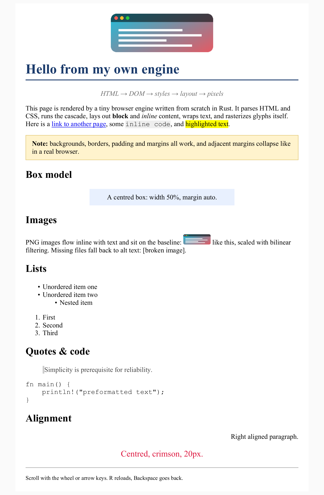
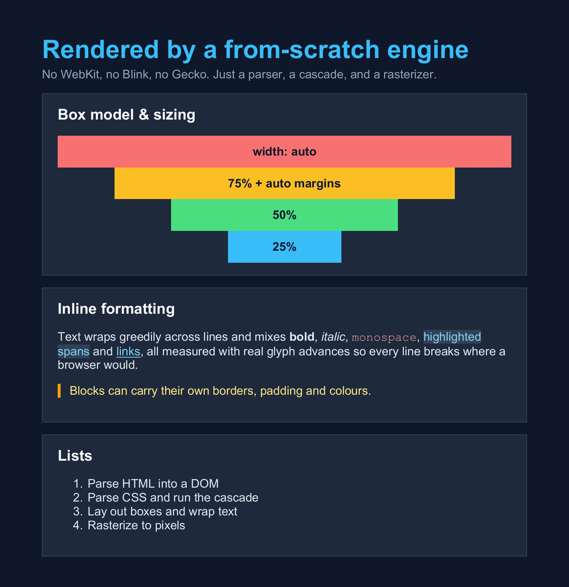
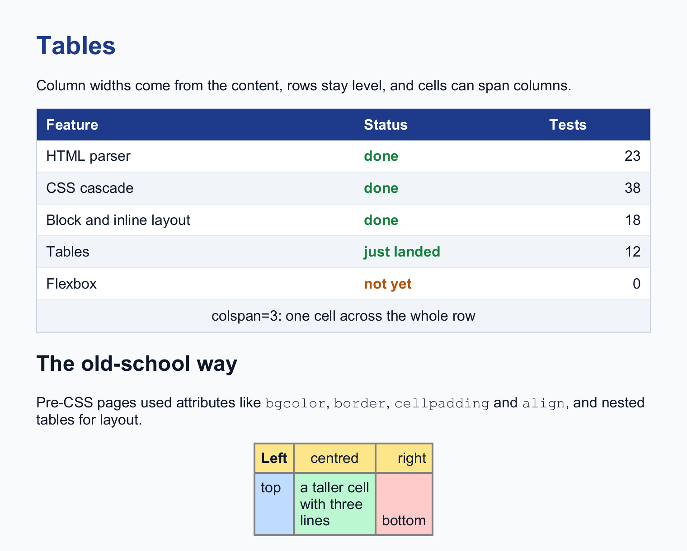

# mybrowser

I wanted to understand what a browser actually does, so I'm writing one from scratch in Rust. The goal is a *functional* browser: type an address, fetch the page over HTTPS, parse the HTML and CSS, lay it out, and paint it. There's no WebKit or Blink underneath and no UI toolkit doing the text layout for me. Only the window, the TLS stack, the font rasterizer and the image decoders come from crates.

It is early. It can load and read plain, document-style websites today, including older table-based ones like Hacker News, and it falls over on anything that depends on JavaScript, grid or floats. The [roadmap](#whats-missing) below is honest about the distance to a real browser.

<p align="center">
  
  
  
  
</p>

All the screenshots come from the engine itself. The `--screenshot` flag runs the same layout and paint code as the window, just into an image instead (the page only, without the tabs and toolbar).

## Try it

You need Rust installed. Then:

```sh
cargo run --release                      # opens the demo pages
cargo run --release -- https://example.com
cargo run --release -- some/local/page.html
```

The window has a tab strip, a toolbar with back, forward and reload buttons, and an address bar. You can type a full URL, a bare hostname like `example.com/docs`, or a path to a local file. Pages load in the background: the current page stays on screen and responsive until the next one arrives, and `Esc` cancels a load. Open `pages/forms.html` to try the form controls.

| Key | Action |
|---|---|
| `Cmd+T`, `Cmd+W` | New tab, close tab (the last tab is replaced by an empty one). A middle click on a tab closes it too |
| `Cmd+Shift+T` | Reopen the most recently closed tab (the last 25 are remembered; empty tabs aren't) |
| `Ctrl+Tab`, `Ctrl+Shift+Tab`, `Cmd+1`…`Cmd+9` | Next / previous tab, jump to a tab (`Cmd+9` is the last one) |
| `Cmd+click` a link | Open it in a new tab |
| `Cmd+F` | Find in page: type to search, `Enter` / `Shift+Enter` (or `Cmd+G` / `Cmd+Shift+G`) for the next / previous match, `Esc` to close |
| `Cmd+L` (or `Ctrl+L`) | Focus the address bar and select it |
| `Cmd++`, `Cmd+-`, `Cmd+0` | Zoom the page in or out (50% to 300%, per tab; the toolbar and tabs keep their size) and back to 100% |
| `Cmd+D`, `Cmd+Shift+B` | Bookmark the page (again to remove its bookmark), open the bookmarks list (`about:bookmarks`) |
| `Enter` / `Esc` | Go to the typed address / cancel editing, or cancel a load in progress |
| `Cmd+V`, `Cmd+C`, `Cmd+A` | Paste, copy and select all in the address bar (macOS); `Cmd+V` and `Cmd+C` also paste into and copy from a focused text field on a page (never from a password field), and `Cmd+←` / `Cmd+→` jump to the start or end of the text there |
| `Cmd+[`, `Cmd+]`, `Alt+←`, `Alt+→`, `Backspace` | Back and forward |
| `Cmd+R`, `F5`, `R` | Reload |
| Wheel, arrow keys, `Space`, `PgUp`, `PgDn`, `Home`, `End` | Scroll |
| Click a field, then type | Edit it. `Tab` / `Shift+Tab` move between controls, `Enter` submits, `Esc` leaves the field, `Space` toggles checkboxes and presses buttons. In a text field the arrow keys, `Home`, `End` and `Delete` move the caret and edit; on a focused select, `↑`/`↓`/`Home`/`End` step through the options |

To render a page to a PNG without opening a window (this works on URLs too):

```sh
cargo run --release -- --screenshot out.png --width 900 --scale 2 https://example.com
```

One heads-up: fonts are loaded from the macOS system font folder (see `src/fonts.rs`), so this only works on a Mac for now. The window code is cross-platform, so on Linux or Windows you'd just need to point the font loader at some TTF files.

## What it can do

**Networking.** It loads `http://` and `https://` pages (TLS through rustls, gzip, timeouts, a size limit), as well as local files and `data:` URLs. It sends `GET` requests and form `POST`s. Redirects are followed by hand so cookies carry across each hop and a redirect can never lead to a `file:` or `data:` URL; after a `POST`, 301/302/303 redirects are followed with a `GET` and 307/308 repeat the `POST` (never from https down to http), like in other browsers. Stylesheets and images are fetched in parallel by a small worker pool with a deadline, and the `Accept` header lists the image formats it can decode. It honours `<base href>` for links, form actions, images and stylesheets, decodes UTF-8, UTF-16, Latin-1 and Windows-1252 text, saves files it can't display (a zip, a PDF) from a web server to `~/Downloads` when you open a link or address that leads to one (the page you were on stays, the address bar says where the file went; a page can't start a download for you with a meta refresh, and Reload, Back, Forward and reopening a closed tab never fetch it again). The file is never opened, names are cleaned (no path tricks, no hidden or direction-changing characters), nothing is overwritten (`name (1).zip` for duplicates), and macOS is told the file came from the internet so Gatekeeper checks it. Error pages and empty responses are never saved, and unknown `text/*` types show as text. It also shows readable pages for plain text, images and errors (including HTTP 404s with their bodies). A web page can't load local files or send you to one.

**Cookies and privacy.** One in-memory cookie jar is shared by every request and never written to disk. Beyond the usual host, path and expiry rules it refuses a `Domain` that is a public suffix (so `Domain=co.uk` can't make a supercookie), refuses `Secure` cookies from plain http, never sends them over it and doesn't let a plain-http response overwrite one, enforces the `__Secure-` and `__Host-` prefixes, and caps cookie size and count. When a site goes over its limit it loses its own oldest cookies, never another site's. `SameSite` works the way browsers now do it: cookies without the attribute count as `Lax`, so a form on another site can't POST with your login cookie (no CSRF), `Strict` cookies never leave their site (even if a redirect chain leaves the site and comes back), and `SameSite=None` needs `Secure`. Images and stylesheets from a different site than the page get no cookies at all, in either direction, so a tracking pixel can't recognise you. No `Referer` is sent.

**Browsing.** Tabs, each with its own page, history, scroll position and load in flight: a slow load in a background tab lands in the right tab when it finishes, and closing a tab abandons its loads. Pages load on background threads, so the window never freezes; only the newest navigation in a tab can land, so a slow load can't replace a page you've moved on from. Back and forward history changes only when a navigation actually lands, so cancelling or superseding a load never loses or duplicates entries, and typing the address you're already on reloads instead of adding an entry. Back and Forward return to where you had scrolled each page to (the tab remembers up to 200), and the last six pages you left are kept in memory whole, so going back to one is instant and shows it as you left it, typed form data included (and a page a form POST produced comes back as it was instead of being fetched again with a GET). Older ones are fetched again; Reload always fetches. Pages that failed to load, and pages whose server sent `Cache-Control: no-store` (a bank, a mailbox), are never kept: Back fetches them again. A page with `<meta http-equiv=refresh content="0; url=...">` sends the tab on to that address straight away and replaces itself in the history (a chain of them is cut off after five, and refreshes with a delay are ignored, since there are no timers yet). **In-page anchors** work: a link to `#section` scrolls to the element with that `id` (or `<a name>`, including empty ones between paragraphs, table rows and cells, and inline ones deep inside a long paragraph, which land on their own line), `#` and `#top` go to the top, the address bar and history follow the fragment (Back and Forward between fragments of one page just scroll, with no reload), and opening `page.html#section` lands on the section once the page has been laid out, even if the server redirected on the way. **Find in page** searches the text that is actually on screen (hidden elements aren't found), highlights every match, marks the selected one, shows "3 of 12", and scrolls to each match as you step through them. It is case-insensitive, finds phrases that span bold or link boundaries (but not ones that wrap onto a second line or run from one table cell into the next), treats a non-breaking space as a space and ignores zero-width and bidi control characters.

**Forms.** Text, password, checkbox, radio, submit and button inputs, `<button>`, `<textarea>` and `<select>` draw as native-looking boxes that sit on the text baseline. Click to focus, type, paste, toggle and cycle options; `Tab` and `Enter` work. Clicking a `<label>`'s text (with `for=`, or around its control) focuses or toggles that control. Disabled controls (including those in a `<fieldset disabled>`, except in its first `<legend>`) can't be clicked, `readonly` and `maxlength` are honoured, and `hidden` controls skip the Tab order. Submitting builds a properly URL-encoded body (only the clicked button, only checked boxes, one value per radio group, no disabled or nameless controls, hidden fields included, textarea line breaks as CRLF) and either navigates with it as a query (`GET`) or sends it (`POST`). `form="id"` ties a control to a form elsewhere on the page, and `formaction`/`formmethod` on the clicked button override the form's. The target goes through the same safety checks as links, and a form on an https page refuses to send its data to plain http. Pressing Enter twice doesn't send a `POST` twice. Password text is never drawn.

**HTML.** Entities, void tags, messy markup (unclosed `<p>` and `<li>`, misnested tags, stray end tags, implied table rows and cells), and a synthesized `<head>` and `<body>` when a page leaves them out. The parser runs in linear time, even on hostile input.

**CSS.** `<style>` blocks, linked stylesheets and inline styles. Selectors: tag, class, ID, `*`, attribute selectors (`[href]`, `[type=text]`, `^=`, `$=`, `*=`, `~=`, `|=`, and the `i`/`s` flags; values of HTML keyword attributes like `type` and `lang` ignore case, as in browsers), `:first-child`, `:last-child`, `:only-child`, `:nth-child()` and its `last`/`of-type` relatives, `:link`, `:root` and `:not()`, with descendant, `>`, `+` and `~` combinators. Selectors that need state the browser doesn't keep (`:hover`, `:focus`, `:visited`) or pseudo-elements (`::before`) are dropped rather than misapplied. Specificity, source order, `!important`, origin (author rules beat the built-in stylesheet), inheritance, and `inherit`/`initial`/`unset`. Most of the box model: width, max-width, height, padding, borders, auto margins, `box-sizing`, and margin collapsing including the awkward cases. Colors in hex, `rgb()`, `hsl()` and by name; the `font` and `border` shorthands. The `hidden` attribute hides an element.

**Layout.** Block and inline flow, lists, `<pre>`, and **tables**: column widths from min and max content, percentage and fixed widths, `colspan` and `rowspan`, captions, row and cell backgrounds that stretch to the row, vertical alignment, nested tables, and the legacy attributes older pages rely on (`border`, `cellpadding`, `cellspacing`, `bgcolor`, `align`, `valign`, `<font>`). `<details>` is collapsible: closed unless it has `open`, and clicking its `<summary>` heading (anywhere on it, except on a link; it gets a ▶ / ▼ triangle) toggles it. A `#fragment` link to something inside a closed one opens it, controls inside a closed one can't be tabbed to, and a details with no summary is left open since it couldn't be reopened. There is no keyboard way to toggle one yet. A **flexbox subset**: `display: flex` rows with `flex-wrap`, `gap`, `justify-content` (all six values), `align-items` (start, center, end), and items sized by `flex`, `flex-grow` and `flex-basis`, shrinking towards their min-content width when there isn't room. `flex-direction: column` stacks like a normal block.

**Text and images.** Text wraps using real glyph widths with alignment, bold, italic, monospace, underlines, highlights and clickable links. Characters missing from the main fonts (arrows, CJK) fall back to a wide-coverage font. PNG, JPEG (including CMYK), GIF and WebP (lossy, lossless and with transparency) images flow inline with the text, scaled with bilinear filtering, with alt text as the fallback. The format is recognised from the bytes (a JPEG named `.png` still works), a GIF or an animated WebP shows its first frame, and every decoder checks the size a file claims before allocating, so a tiny file can't demand gigabytes. A decoder that crashes on a corrupt file costs that one picture, not the page.

## How it works

The engine is a pipeline, and each stage only looks at the output of the one before it:

```
URL -> fetch -> HTML -> DOM --\
                               +-> styles -> layout -> display list -> pixels -> window
         CSS, images <---------/
```

| Stage | File | Notes |
|---|---|---|
| Loading | `src/net.rs`, `src/cookies.rs` | `file:`, `http(s):` and `data:` URLs, `GET` and `POST`, hand-followed redirects, limits, content sniffing, charset decoding. The cookie jar and its policy live in `cookies.rs`. |
| HTML to DOM | `src/html.rs`, `src/dom.rs` | One pass over the text with a stack of open elements. The DOM is a flat `Vec` of nodes that refer to each other by index, which keeps Rust's ownership rules out of the way. |
| CSS parsing | `src/css.rs` | Parses rules, matches selectors right to left (with memoization so deep trees stay fast), and expands shorthands like `margin: 0 auto` into their individual properties up front. |
| Styles | `src/style.rs` | Walks the DOM once, collects every matching declaration, sorts by importance, origin, specificity and order, and fills in a typed `Style` for each node. Legacy presentational attributes act as very low-priority rules. |
| Forms | `src/forms.rs` | Pure logic: which elements are controls, their typed or chosen values, Tab order, and turning a submitted form into a request. |
| Layout | `src/layout.rs` | Stacks blocks, collapses margins, breaks text into lines, sizes and positions table cells and form controls. The output is a flat list of "draw this rect" and "draw this text" commands, plus where every `id` landed. |
| Painting | `src/paint.rs`, `src/fonts.rs`, `src/images.rs` | Fills rectangles into a `u32` buffer, blends glyph bitmaps and scaled images on top; also draws the toolbar, tab strip and find overlay. `images.rs` decodes PNG, JPEG, GIF and WebP. |
| Browser | `src/page.rs`, `src/tab.rs`, `src/tabbar.rs`, `src/chrome.rs`, `src/find.rs`, `src/main.rs` | A page ties the stages together; a tab owns a page, its history and its loads; the tab strip, toolbar and find state are pure logic and geometry; `main` runs the window and routes input. |

A few choices worth explaining:

- Layout produces drawing commands instead of a tree of boxes. Painting is then just "run through the list in order", and scrolling only repaints with an offset. Layout reruns when the window width changes or a form control changes (it's cheap).
- Selectors I don't support (`a:hover`, `::before`) get dropped rather than approximated. Ignoring a rule is better than applying `a:hover` styles to every link. The same goes for the `:visited` state: the browser keeps no visited-link record, so every link is `:link`.
- Invalid CSS values are ignored instead of resetting the property, so the common "fallback, then modern value" pattern works.
- Table cells are laid out once and then stretched: a row's height isn't known until every cell is done, so backgrounds and borders are patched afterwards instead of laying each cell out twice (which would be exponential for nested tables). The recorded position of every `id` inside a cell is shifted along with the cell's content, so `#fragment` links into a vertically centred cell still land in the right place.
- Form controls are drawn by the engine from plain rects and text, so they need no new paint code, and a control's size never depends on what's typed in it, so typing doesn't reflow the page.
- Find in page searches the display list rather than the DOM. The layout already knows what is visible and where it is, so there's nothing to keep in sync, and the match positions come straight from the same glyph measurements that drew the text. The layout emits one item per word, so the search stitches each visual line back together first, and the empty placeholder item that starts every block and table cell tells it where a line must end.
- The HTTP client's built-in cookie handling and redirect following are switched off. I wanted every cookie to pass through my own rules first, and a redirect to be checked before it's followed, so both happen in `net.rs` and `cookies.rs`.
- `SameSite` needs to know which page started a navigation (a clicked link or submitted form, as opposed to a typed address). That is passed to the loader thread through a thread-local, so the page-loading code didn't have to change.
- A tab doesn't know about the window: loader threads report back through a plain callback carrying the tab's id, so a tab (its history, its stale-load handling, its form submission) is unit-tested by feeding it local files.
- A page is built whole on a loader thread and handed to the UI thread in one piece. It contains `Rc`s (not `Send`), so the handoff uses a tiny `unsafe impl Send` whose safety argument (every clone lives inside the one value being moved) is written next to it and was reviewed independently.
- The address bar logic, the tab strip geometry, the find state, the form logic, the cookie policy, and the navigation and history bookkeeping are plain state with no windowing in them, so they're unit-tested.

## Dependencies

The engine itself is hand-written. I only used crates for the parts that talk to the operating system or are a project of their own:

- `winit` for the window and input events
- `softbuffer` to put a pixel buffer on screen
- `fontdue` to turn a TrueType glyph into a bitmap and report its metrics
- `ureq` (with rustls) for HTTP and TLS, and `url` for parsing and resolving URLs
- `cookie_store` and `cookie` to parse and match cookies, and `psl` (the public suffix list) to know which domains cookies must never be shared across
- `png`, `jpeg-decoder`, `gif` and `image-webp` to decode images (`png` also saves screenshots)

## Tests

```sh
cargo test
```

There are about three hundred tests. They cover the parsers, selector matching, the cascade, layout, tables and form controls, address editing, tabs, in-page anchors, find in page, image decoding, URL handling, history, form submission, the cookie rules, and networking (against throwaway local HTTP servers, so no internet is needed). Many are regression tests for real bugs found by throwing nasty input at the engine and by independent review passes: quadratic-time parsing, exponential selector matching, crashes on odd Unicode and huge values, unbounded memory use, history desyncs, and so on. The tests load system fonts, so they also need macOS for now. A few tests check that something runs fast; they can fail on a heavily loaded machine and pass when run alone.

## What's missing

The honest list, roughly by how much it matters for a real browser:

- **JavaScript.** Nothing runs yet. The first piece exists: a lexer and parser for a practical subset of the language (`src/jsparse.rs`: functions and arrow functions, objects and arrays, all the usual statements and operators, template literals, automatic semicolon insertion; tagged templates, array holes and `<!--` comments work; no classes, `async`, destructuring or regular expression literals). Scripts are parsed on a thread with a big stack, with limits on nesting, chain length and template depth so hostile scripts can't overflow it. A tree-walking interpreter for that subset also exists (`src/js.rs`: closures, `this`, `new` and prototypes, exceptions, arrays and strings with their usual methods, `Math`, `JSON.parse` and `stringify`, `bind`/`call`/`apply`, `Object.keys`/`assign`/`entries`, `console.log`, and limits on steps, call depth, nesting, objects and memory, with native methods charged for the size of what they touch, so a script can't hang, crash or exhaust the browser), and it now runs on pages. While a page loads, its `<script>` tags (inline, and `src` ones fetched like any other resource; an http page can't pull in a local file) run in order against the DOM, with `document` (`getElementById`, `querySelector(All)`, `createElement`, `createTextNode`), elements (attributes, `classList`, `textContent`, `innerHTML`, `appendChild`/`removeChild`/`insertBefore`, an `element.style` object that reads and writes the inline `style` attribute: `style.display = 'none'`, `setProperty`, `cssText`), `addEventListener` with bubbling and `preventDefault`, and `setTimeout`/`setInterval` on a virtual clock; whatever the scripts leave behind is what gets styled and laid out. A script that fails or runs away is logged and the rest of the page loads anyway. Memory is limited by what a script really holds (measured per thread), not by what it asked for. Clicks on links and form controls reach the scripts' handlers (`preventDefault()` stops the link or control from doing its usual thing), and after a handler runs the page is restyled and laid out again; clicks on plain text don't yet, because only links and controls are hit-tested. Still missing: there's no `fetch` or `XMLHttpRequest`, and things like classes, `async` and regular expressions don't parse, so modern framework-built pages still won't work.
- **Layout.** Flexbox is only a subset: items keep their own height (no stretching of backgrounds to the tallest item), text written directly inside a flex container is ignored, `row-reverse`/`order`/`align-self` aren't supported (`flex-shrink` is, including `0`), percentage widths, bases and margins on items are treated as auto or zero (`margin: auto` works), `min-width`/`max-width` on items don't affect their slot, margins and padding on inline items are dropped, a container holds at most 2000 items, and `inline-flex` acts as inline. No grid, floats or positioning, no inline padding or margins, and no `vh`/`vw`/`calc()`. A lot of the modern web depends on these.
- **CSS.** No `@media`, pseudo-elements (`::before`), `:hover`/`:focus`/`:target` states, `:is()`/`:where()`, or `:checked`/`:disabled`.
- **Forms.** No `multipart/form-data` (so no file uploads; a form asking for it is sent urlencoded), no `<select multiple>`. Reloading a page a `POST` produced, or going back to one that has fallen out of the six-page memory, fetches its URL with a `GET`. Single-line fields have a movable caret (arrow keys, Home, End, Delete), but there is no selection and a `<textarea>` still only edits at its end. No file, date or colour inputs, radio buttons draw as squares, and selects cycle on click instead of opening a menu. Controls hidden with CSS (`display:none`) can still be tabbed to. A page whose markup checks several radios of one group draws them all checked (only the last is submitted).
- **Tabs.** No dragging to reorder. A reopened tab starts fresh (no back history, scroll position or typed form data). With many tabs open they shrink until only the close button shows (at most 20 can be open).
- **Cookies.** Nothing persists between runs, and there's no UI to see or clear them.
- **Browser features.** No HTTP caching. Bookmarks are a plain list (`~/.mybrowser/bookmarks.tsv`, web and local pages only; the file is private to you, usernames and passwords are stripped from saved addresses, two windows can't overwrite each other, and a file it can't read is never replaced): no folders, editing or import, and removing one means pressing `Cmd+D` on its page. Downloads have no progress, no `Content-Disposition` names and no list; the file just lands in `~/Downloads` and a page says so. A `<base>` tag inside a `<template>` is honoured, and a bad `href` on the first `<base>` doesn't stop the search for the next one.
- **Find and anchors.** Placeholder text in empty fields (and the dots of a password field) is found by search; browsers skip them. An empty `<a name=x></a>` in the middle of a paragraph points at the top of that paragraph rather than its own line.
- **Media.** Animated GIFs and WebPs show their first frame only; no SVG or AVIF. No fonts from the web (`@font-face`).
- **Text.** No shaping, so no kerning, ligatures or complex scripts, and no right-to-left text.
- **Platform.** macOS fonts only, for now.

The order I'm tackling things in: the remaining CSS gaps (inline boxes, viewport units, flex stretching), and eventually a JavaScript engine. Until then it's best at documents, blogs, articles and older table-based sites.

## Where to learn more

If you want to go deeper, these are all good:

- Matt Brubeck's [Let's build a browser engine](https://limpet.net/mbrubeck/2014/08/08/toy-layout-engine-1.html) series
- [Web Browser Engineering](https://browser.engineering/) by Pavel Panchekha and Chris Harrelson
- The [CSS 2.1 spec](https://www.w3.org/TR/CSS21/), especially the sections on visual formatting and margin collapsing
